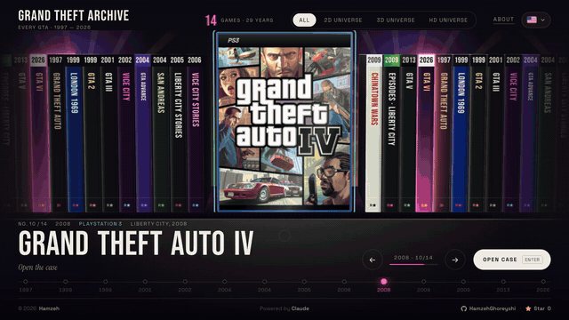

# Grand Theft Archive — every GTA, 1997–2026

<a href="https://rockstar-gta-history.vercel.app"></a>

The whole Grand Theft Auto series on one 3D shelf. Each game sits in the packaging of the console
it was made for: PS1 jewel case, PS2 DVD case, GBA box, PSP UMD case, DS case, PS3, Xbox 360, PS5.
Pull a case out, open it, and see the disc or cartridge, real period screenshots, and a production file
(budget, development time, team size, sales). GTA VI is set apart, with a glow and a live launch countdown.

```bash
npm install
npm run dev      # http://localhost:5173
npm run build    # static site in dist/
```

Live: https://rockstar-gta-history.vercel.app · pushes to `main` deploy automatically.

## Languages

English (default) and Persian. Add `?lang=fa` to the address or use the flag menu. Persian uses the Ravi font
(loaded from word-capsule-fonts.vercel.app), right-to-left layout and Persian digits. Interface strings: `src/i18n.js`;
game text in Persian: `src/data/games.fa.js`.

## How it is built

| Part | File | What it does |
|---|---|---|
| Data | `src/data/games.js` | Every game, its facts, images, era and console edition. The only file you edit to change the shelf. |
| Case | `src/components/GameCase.js` | One 3D case from six CSS faces + a hinged lid, styled per console edition. |
| Media | `src/components/Disc.js` | CD / DVD / Blu-ray disc, PSP UMD, or GBA / DS cartridge as its own 3D object. |
| Shelf | `src/components/Shelf.js` | Endless shelf with a spring. GTA VI sits in line but glows (neon stroke, rays, sparks). |
| Open case | `src/components/OpenCase.js` | Takes the case off the shelf, swings the lid 180°, reveals media + details. Esc reverses it. |
| Details | `src/components/GameDetails.js` | Story, specs, Metacritic, production file, "Remember this?" screenshots. |
| GTA VI | `src/components/GtaShowcase.js` | Official Rockstar gallery instead of a disc + Vice City section. |
| Countdown | `src/components/Countdown.js` | Live days/hours/min/sec to GTA VI's local-midnight unlock. |
| i18n | `src/i18n.js`, `src/data/games.fa.js` | English/Persian strings, flags, digits. |

## Record the video

`tools/record.mjs` films the walkthrough frame by frame at 60 fps (the page's clock is driven by the script, so no frame is dropped). A real mouse drives the site's own cursor. Needs Google Chrome and ffmpeg.

```bash
npm run build
npm i --no-save puppeteer-core
node tools/record.mjs exports/grand-theft-archive-16x9.mp4 1280 720 1920
node tools/record.mjs exports/grand-theft-archive-9x16.mp4 432 768 1080
```

Arguments: output file, page width, page height, video width. Add `fa` at the end for Persian.

## Sources and honesty rules

- Facts: each game's English Wikipedia article and the reporting it cites (checked 2026-11-17).
  Anything never made public shows **Not disclosed**. Outside estimates are labelled as estimates.
- Images: official Rockstar cover art and period screenshots from rockstargames.com (loaded from Rockstar's CDN,
  resized on request). GTA Advance has no Rockstar page, so its title screen and a cartridge photo come via Wikipedia.
- Disc and cartridge labels show the cover art (no scans).
- Images are hotlinked: if Rockstar renames files they stop loading. Self-host them to make it permanent.

Fan project. Not affiliated with or endorsed by Rockstar Games, Take-Two, Sony, Microsoft or Nintendo.
